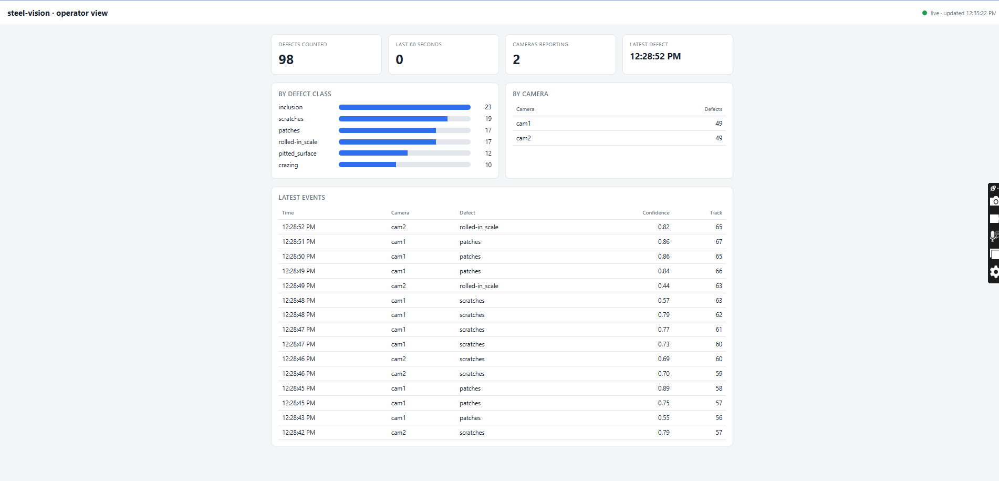

# steel-vision

A simulated multi-camera inspection pipeline for steel-surface defects: detect defects, track and count them, and report them to a PLC alarm, an event log and an operator dashboard.

> **Scope, stated plainly.** Everything here is built on public images (NEU-DET). The "cameras" are RTSP video streams generated from those images, and the "PLC" is a simulated Modbus server. There is no real plant hardware, no real lighting or vibration, and no calibration to physical units. Section [Limitations](#limitations) lists what these results do and do not show.

## Results at a glance

| Question | Answer (measured on the NEU-DET validation split, 100 images / 232 boxes) |
|---|---|
| Learned detector vs classical image processing | YOLOv8s F1 **0.79** vs classical **0.25** (IoU ≥ 0.3); **0.70** vs **0.14** (IoU ≥ 0.5) |
| Cost of running on a small CPU | Input size 640 → 320: median latency **439 → 104 ms** with no measurable F1 loss (Intel i3-7020U) |
| Counting defects on a moving strip, sampled at ~2.3 FPS | Overlap-based tracker (ByteTrack defaults): recall **0.17**. Tracker using the belt speed: recall **0.76**, precision **0.91** |
| Does it survive faults? | Camera drop, PLC down and API down are each tested; no crash and no stale alarms (details below) |

### How results are scored
- **Detection:** one-to-one matching of predicted boxes to labelled boxes at a given IoU, class-agnostic unless stated, YOLO confidence threshold 0.25 (not tuned).
- **Counting:** a defect is counted once, when its box centre crosses a line in the middle of the frame. The true crossing time is known exactly from the labels and the belt speed, and a count is correct if it falls within ±8 frames (0.32 s, 32 px of belt travel) of a true crossing. Other tolerances are in `docs/*.csv`.

## System

```
 simulated cameras (RTSP, 25 FPS, H.264, via MediaMTX)
          │
   StreamReader  ── keeps only the newest frame, reconnects with backoff
          │
   YOLOv8s (ONNX, 320 px) ──► SpeedTracker (uses belt speed) ──► LineCounter
                                                                     │ one event per counted defect
                              ┌──────────────────────────────────────┤
                              ▼                                      ▼
                    Event-log API (FastAPI,                  Modbus alarm (relay pulse +
                    SQLAlchemy: SQLite/PostgreSQL)           counter register, simulated PLC)
                              │
                       operator dashboard (plain HTML/JS, served by the API)
```

## Findings

### 1. Learned detector vs classical image processing

Classical baseline: background subtraction, Otsu threshold, morphology, contours. YOLOv8s was fine-tuned on 1,700 training images (3,957 boxes) for 50 epochs at 640 px on a free Colab GPU (seed 0). Both are scored by the same code on the same 100 validation images.

| | classical F1 | YOLOv8s F1 |
|---|---|---|
| All classes, IoU ≥ 0.3 | 0.25 | **0.79** |
| All classes, IoU ≥ 0.5 | 0.14 | **0.70** |
| crazing (IoU ≥ 0.5) | 0.00 | 0.32 |
| inclusion | 0.13 | 0.83 |
| patches | 0.03 | 0.86 |
| pitted surface | 0.46 | 0.79 |
| rolled-in scale | 0.03 | 0.50 |
| scratches | 0.21 | 0.83 |

- Classical methods only compete on pitted surface. No single morphology setting suits all classes: small kernels catch more but fire many false boxes (kernel 3: precision 0.06), large kernels delete real defects (kernel 21: recall 0.18). Settings can't be chosen per class in deployment because the class isn't known beforehand.
- Crazing and rolled-in scale are the hardest classes for both methods. Their labels are loosely bounded regions: crazing F1 falls from 0.59 to 0.32 between IoU 0.3 and 0.5.
- Defect type is almost never confused: requiring the correct class barely changes the score (0.79 → 0.79 at IoU ≥ 0.3). Every NEU-DET image contains a single defect type, so this says little about mixed scenes.

Evidence: `docs/compare_classical_vs_yolo.csv`, `docs/classical_sweep.csv`, `docs/classical_valid.png`, `docs/results.png`, `docs/confusion_matrix.png`.

### 2. Input size and runtime on a small CPU

NEU-DET images are only 200 px wide, so running the model at 640 px mostly processes upscaled pixels. Measured on an Intel Core i3-7020U (4 logical cores), 100 images, first 5 excluded as warm-up, end-to-end per image (preprocess + inference + postprocess):

| backend | input | median ms | p95 ms | FPS | F1 (IoU ≥ 0.5) |
|---|---|---|---|---|---|
| PyTorch | 640 | 438.7 | 666.4 | 2.3 | 0.70 |
| ONNX Runtime | 640 | 358.1 | 429.9 | 2.8 | 0.70 |
| PyTorch | 416 | 165.6 | 183.0 | 6.0 | 0.72 |
| PyTorch | **320** | **104.2** | **117.7** | **9.6** | 0.74 |
| ONNX Runtime | 320 | 103.9 | 128.6 | 9.6 | 0.74 |
| PyTorch | 256 | 78.3 | 90.3 | 12.8 | 0.71 (recall drops to 0.64) |
| ONNX Runtime | 256 | 72.1 | 92.6 | 13.9 | 0.71 |

- Input size was the big lever (about 4× faster from 640 to 320). The F1 rise from 0.70 to 0.74 is within noise for 232 boxes: read it as "no measurable loss".
- ONNX Runtime was at most 1.2× faster than PyTorch on this CPU, with identical F1 at every size (so the export is faithful).
- FP16 and TensorRT need a GPU and are **not** benchmarked here.

Evidence: `docs/benchmark_cpu.csv`.

### 3. Multi-camera ingest

Four simulated cameras (25 FPS H.264 over RTSP) are read by one thread each. Each reader keeps only the newest frame, so latency cannot grow when the model is slower than the cameras, and it counts the frames it skips.

- Without a model, the readers received about 23–24 FPS per camera.
- With YOLO (ONNX, 320 px) on the i3, four cameras were processed at **2.2 FPS each (8.8 total)**, close to the single-stream figure above. Capture-to-result latency stayed at about **134 ms median / 158 ms p95** with about 91% of frames skipped by design. The FFmpeg encoders for the simulated cameras shared this CPU, so a real deployment would differ.
- Reconnect test: all four streams were stopped for about 30 s. Each reader noticed immediately, retried with exponential backoff (0.5 s up to a 5 s cap), reconnected without intervention, and latency was unchanged afterwards.
- Not covered: a camera that stalls silently (connection open, no data) is only caught by the 5 s read timeout, and one that repeats the same frame is not detected at all.

Evidence: `docs/multicam_4cams_yolo_320.csv`, `docs/multicam_4cams_with_dropout.csv`.

### 4. Counting defects on a moving strip

Boxes per frame are not what a plant wants; defects per metre of steel are. Each defect gets an ID from a tracker and is counted once as it crosses a line. The test videos are built from validation images, so the true crossings are known exactly. Processing every 11th frame of a 25 FPS camera (about 2.3 FPS, what this CPU sustains for four cameras):

| tracker | precision | recall | F1 |
|---|---|---|---|
| ByteTrack, default settings (overlap-based) | 0.87 | 0.17 | 0.29 |
| Speed-aware tracker, belt speed set to **0** (control) | 0.97 | 0.48 | 0.64 |
| Speed-aware tracker, true belt speed | 0.91 | **0.76** | **0.83** |
| Speed-aware tracker, speed wrong by ±10% / +25% / ±50% | 0.91–0.92 | 0.74–0.76 | 0.82–0.83 |

- At this sampling rate a small defect moves further between processed frames than its own height, so frame-to-frame overlap fails and ByteTrack loses it. The speed-aware tracker predicts where each defect will be from the known belt speed and matches detections to that prediction.
- The zero-speed control matters: about half of the improvement (0.17 → 0.48) comes from the tracker's permissive matching rather than from speed, and the rest (0.48 → 0.76) from using the speed. ByteTrack was run with its default configuration and **not tuned**, so the gap partly reflects that.
- Recall is robust to a wrong belt speed anywhere from −50% to +50%. This holds in simulation, where the speed is otherwise exact.
- Per-class recall with the speed-aware tracker: patches 0.94, scratches 0.86, inclusion 0.85, pitted surface 0.68, rolled-in scale 0.60, crazing 0.57. The weakest classes are the detector's weakest classes.
- The result depends on matching strictness: precision is 0.84 / 0.91 / 0.93 / 0.96 at tolerances of 5 / 8 / 12 / 30 frames. Crossing times are interpolated between the two sightings around the line; without that, counts at a sparse sampling rate are late by up to one sampling interval.

Evidence: `docs/tracking_eval_stride11*.csv`.

### 5. Plant integration and failure behaviour

A counted defect becomes one event sent to (a) the event-log API and (b) a Modbus alarm on a simulated PLC (one relay coil and one counter register per camera). In a live run with two cameras for 60 s, 98 defects were counted (49 per camera), 98 events were stored and 98 relay pulses were sent, with no errors. For comparison, the offline evaluation found 62 and 69 true crossings per 60 s loop of these two videos, so 49 per camera is in line with the offline recall of about 0.76. This live comparison is by total count only, not matched one-to-one.

| fault | behaviour (covered by automated tests and manual runs) |
|---|---|
| PLC unreachable | the vision loop never blocks; events still reach the API; alarms are queued, and any alarm older than 2 s is **dropped and counted** rather than sent late (a late alarm points at the wrong piece of steel); reconnects when the PLC returns |
| API unreachable | events are buffered in memory (up to 1,000) with their original timestamps, retried with back-off, and delivered oldest-first on recovery; permanently invalid events are dropped, not retried forever |
| camera stream lost | exponential back-off reconnect; tracker state is reset so sightings before and after the gap are never linked |

The API runs on SQLite by default and on PostgreSQL via `DATABASE_URL`; its tests were also run against a real PostgreSQL 16 server. The dashboard is plain HTML/JavaScript (no build step), refreshes every two seconds, shows a red indicator when the API is unreachable, and writes event data with `textContent` only.



## Run it

Windows / PowerShell. FFmpeg (`tools\ffmpeg.exe` or on PATH) and [MediaMTX](https://github.com/bluenviron/mediamtx) are needed for the streaming demo.

```powershell
python -m venv .venv
.\.venv\Scripts\Activate.ps1
pip install -r requirements.txt
python -m pytest -q          # 56 passed, 3 skipped (the PostgreSQL tests need a database)
```

**Data.** Download NEU-DET (a version with annotations and a train/valid split) into `data/neu-det/` with the folders `train_images`, `train_annotations`, `valid_images` and `valid_annotations`, then convert the labels:

```powershell
python -m detect.prepare_data
```

**Training (Colab).** Zip `datasets/neu-det-yolo`, upload it to a Colab GPU runtime, then run:

```python
!pip install -q ultralytics
!unzip -q neu-det-yolo.zip -d /content/
open('/content/data.yaml', 'w').write("""path: /content/neu-det-yolo
train: images/train
val: images/val
names:
  0: crazing
  1: inclusion
  2: patches
  3: pitted_surface
  4: rolled-in_scale
  5: scratches
""")
from ultralytics import YOLO
YOLO('yolov8s.pt').train(data='/content/data.yaml', epochs=50, imgsz=640, batch=32, seed=0,
                         project='/content/runs', name='neu_v8s')
```

Put `best.pt` at `models/neu_v8s/weights/best.pt`. Weights are not committed to this repository.

**Live demo** (one PowerShell window each, repo root, venv active):

```powershell
python -m plc.sim_plc                                   # simulated PLC
python -m uvicorn api.main:app                          # event log + dashboard at http://127.0.0.1:8000/
.\mediamtx.exe                                          # from the MediaMTX folder
python -m ingest.make_strip_video --cameras 4 --seconds 60   # once: builds the camera videos
python -m ingest.stream_videos --cameras 2              # publishes them as RTSP
python -m live.run_live --cameras 2 --seconds 40        # detect, track, count, alarm, log
```

**Docker.** `docker-compose.yml` (PostgreSQL + API + simulated PLC) and its Dockerfile are provided, but the author has **not run them**. The components were tested separately: the API against PostgreSQL 16, and the API and PLC from a folder containing only the files the images copy, using the pinned `docker/requirements-api.txt`.

## Reproduce the numbers

| result | command |
|---|---|
| classical baseline, parameter sweep | `python -m classical.run_demo`, `python -m classical.sweep` |
| classical vs YOLO | `python -m detect.eval_compare` |
| CPU latency / accuracy by input size | `python -m detect.benchmark` |
| multi-camera ingest | `python -m ingest.run_multicam --cameras 4 --seconds 40` (add `--no-detect` for ingest only) |
| tracking, both trackers | `python -m track.run_tracking --stride 11` and `... --stride 11 --tracker speed` |
| belt-speed robustness, zero-speed control | `... --tracker speed --speed-error=0.1` (also `-0.1`, `0.25`, `-0.5`, `0.5`, `-1.0`) |

Each run writes CSVs to `outputs/`; the copies used above are in `docs/`.

## Limitations

- **Simulated, not deployed.** Streams are stitched from still images. Real lines have lighting drift, dust, glare, vibration and speed changes that none of this exercises. Do not read any number here as plant performance.
- **Small evaluation set.** 100 validation images, 232 boxes, 29–47 per class, no separate test set. The same images selected the best checkpoint, the classical settings and the YOLO threshold (so both methods share that advantage), and results come from a single training run (seed 0) with no confidence intervals.
- **One defect type per image** in NEU-DET, which flatters class-confusion numbers.
- **Counting uses a known belt speed.** In simulation it is exact (and robust to ±50% error); on a real line it would come from an encoder or the PLC. ByteTrack was not tuned.
- **No camera calibration.** Pixel-to-millimetre conversion is not implemented, so nothing is reported in physical units.
- **Throughput.** About 2.2 FPS per camera with four cameras on a dual-core i3. This is not real-time multi-camera performance; it needs a GPU or edge accelerator, which was not tested. FP16, INT8 and TensorRT were not benchmarked.
- **PLC and fault tests use a simulated Modbus server.** A real Delta or Siemens PLC would need its own address map, and none was tested.
- **Buffered events live in memory only** and are lost if the process dies.

## Repository layout

```
classical/     image-processing baseline, scoring helpers, parameter sweep
detect/        label conversion, YOLO-vs-classical evaluation, CPU benchmark
ingest/        simulated cameras, RTSP publishing, threaded readers with reconnect
track/         line counter, speed-aware tracker, tracking evaluation and diagnostics
plc/           simulated Modbus PLC and the alarm client
integration/   event sinks (API + alarm) with buffering, and a demo
live/          the end-to-end runner
api/           FastAPI event log and dashboard
docker/, docker-compose.yml   container files (not run by the author)
tests/         unit and integration tests
docs/          result CSVs and figures
```

## Data and credits

Defect images and labels: NEU surface defect database (Northeastern University; Song and Yan, 2013). Detector: Ultralytics YOLOv8. Streaming: MediaMTX and FFmpeg. Modbus: pymodbus. The dataset is not redistributed here.